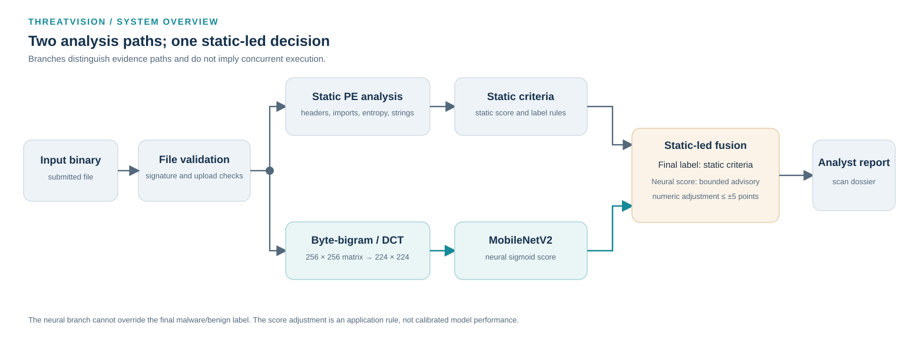
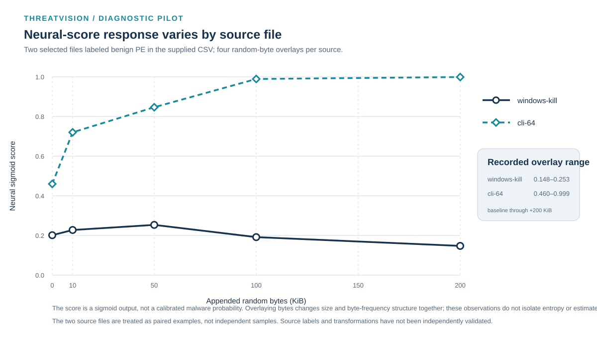
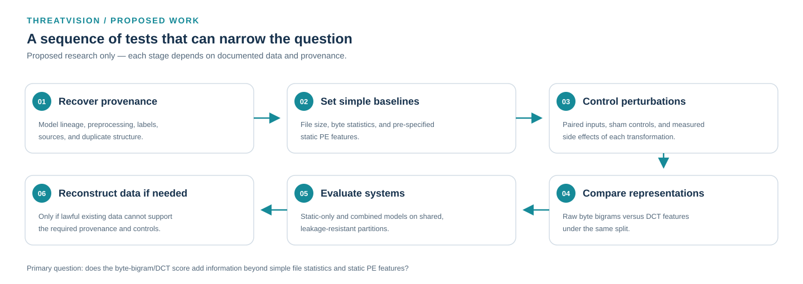

# ThreatVision

### Malware Triage with Static Analysis and Frequency-Domain Neural Features

**Ahsan Ali Salamat** · Software Engineering Final Year Project · The University of Faisalabad · Post-submission technical investigation

I independently designed and implemented ThreatVision's technical architecture, software, and integrations. The university records the original FYP as a group submission by Ahsan Ali Salamat and Usman Manzoor; this formal record is distinct from technical authorship.

ThreatVision combines static PE analysis with a byte-bigram/DCT image path and a MobileNetV2 neural score. The transform follows prior work by Mohammed et al. (2021); the project contribution is the system implementation and integration. Static criteria determine the final malware/benign label. Neural inference can adjust the numeric threat score by at most five points.

**Research question:** Does the byte-bigram/DCT neural representation provide incremental malware-classification information beyond simple file statistics and static PE features? The evidence below is a limited diagnostic pilot, not a malware-detection benchmark.

*Figure 1. ThreatVision system overview. The branches show distinct evidence paths and do not imply concurrent execution. Static criteria determine the final label; the neural score has bounded influence on the numeric risk score.*

## How bytes become model input

The implemented representation counts adjacent byte pairs, suppresses the `(0,0)` cell, normalizes and quantizes the matrix, applies an orthonormal 2D DCT-II, compresses coefficient magnitudes, and resizes the result. The transform is based on [published frequency-domain work](docs/references.md), not a newly proposed representation.

*Figure 2. Synthetic teaching example only. The sequence, matrix slice, and schematic frequency plane are illustrative; no observed file, feature map, or model output is shown. See the [methodology](docs/methodology.md) for the complete transformation.*

## Diagnostic observation

The supplied pilot CSV contains 46 artifacts: ten rows labeled benign PE, twenty transformations derived from two PEs, and sixteen synthetic or out-of-domain probes. The chart shows the two source-dependent responses to selected random-byte overlays, with each original file as the zero-overlay baseline. Nine of the ten benign-labeled PE rows had a neural score below 0.50.

*Figure 3. Neural scores for two selected files labeled benign PE in the supplied CSV and their four overlay derivatives. Scores are sigmoid outputs, not calibrated malware probabilities. The interventions change size and byte representation together; they do not isolate entropy. Rows are paired by source and are not independent experimental units.*

## What the evidence supports

| Established in this record | Observed in the pilot | Still unproven |
| --- | --- | --- |
| Static criteria determine the final label; the neural score has a bounded numeric adjustment. | Score responses to overlays differed across two source files; three of eight overlay rows received a final malware label. | Malware-detection performance, calibrated probabilities, a general entropy shortcut, or an entropy-only causal effect. |
| The deployed archive records a MobileNetV2-based architecture and saved compile configuration. | Two histogram-preserving byte shuffles retained size and recorded entropy while scores fell. | Training-data identity, independent label validity, and the checkpoint's full lineage. |
| The public repository documents the implementation and a small post-submission study. | Synthetic random streams received high neural scores in this set. | Generalization to a lawful, independently labeled malware corpus. |

The pilot has no known-malicious PE cohort or independently verified labels. Twenty transformed observations derive from two files, so the 46 rows are not 46 independent experimental units. The sample-level CSV, original input files, and runnable experiment are not published; rights and provenance remain unresolved. See the [experimental record](docs/experimental-record.md) and [findings and limitations](docs/findings-and-limitations.md).

## Proposed research

The first proposed experiment compares regularized logistic regression using pre-specified file statistics and static PE features with the same model plus the frozen neural score. It requires lawful raw PE files and independently documented labels, duplicate- and source-aware chronological splits, train-only scaling, validation-based model selection, and a pre-specified test metric and practical margin. If the neural score adds no practically meaningful held-out information, the incremental-value hypothesis is not supported. This experiment has not been run.

*Figure 4. Proposed work only; none of these experiments is presented as completed.* See the detailed [future research plan](docs/future-research.md).

## Application screenshot

No approved analyst-interface screenshot was present in the inspected project assets. The local assets included logos and feature-image examples, but not a verifiable dashboard capture. A real interface screenshot can be added after author approval and review for private data and redistribution rights; no mock interface is substituted here.

## Documentation

| Area | Documents |
| --- | --- |
| Research background and methodology | [Background](docs/research-background.md) · [Methodology](docs/methodology.md) · [Dataset provenance](docs/dataset-provenance.md) |
| Implemented architecture | [System architecture](docs/system-architecture.md) · [Model architecture](docs/model-architecture.md) · [Model card](docs/model-card.md) |
| Experimental evidence and limitations | [Experimental record](docs/experimental-record.md) · [Findings and limitations](docs/findings-and-limitations.md) |
| Post-submission investigation | [Investigation account](docs/post-submission-investigation.md) |
| Future research and prospectus | [Future research](docs/future-research.md) · [Prospectus (Markdown)](docs/research-prospectus.md) · [Prospectus (DOCX)](docs/research-prospectus.docx) |
| References and citation | [References](docs/references.md) · [BibTeX](references.bib) · [CITATION.cff](CITATION.cff) |

## Authorship and availability

I independently implemented ThreatVision's technical system. The original FYP's formal university record remains a group submission, as described above. This repository publishes research documentation only; it excludes application source, model weights, input binaries, training data, and the sample-level measurements pending provenance and rights review. No repository reuse license has been selected. Citation metadata is provided in [CITATION.cff](CITATION.cff).
