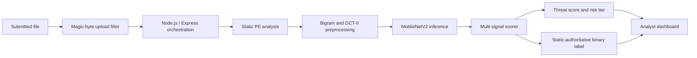

# ThreatVision: A Static-Analysis-Led Malware Triage Framework with Frequency-Domain Neural Features

ThreatVision began as a collaborative undergraduate Software Engineering final-year project at The University of Faisalabad. We implemented a Windows file-triage workflow that combines a byte-bigram/DCT image representation, a MobileNetV2-based neural score, PE static analysis, and a web interface. The byte-to-image method follows prior research; the deployed CNN is advisory, and static analysis controls the final malware/benign label. After submission, I continued examining the model's behavior and the evidence available to evaluate it. That investigation raised unresolved questions about shortcut learning, data quality, and generalization. This repository documents the completed engineering phase and the limits of what the available evidence can establish.

## Abstract

ThreatVision transforms adjacent byte-pair counts into a frequency-domain image and evaluates that image with a MobileNetV2-based model. In a separate processing stage, static analysis extracts PE structure, imports, entropy, strings, and selected opcode indicators. A fusion scorer uses static criteria as the authority for the binary verdict and permits the CNN to modify the numerical score by no more than five points. The project demonstrates integration of these components into a scan-reporting application. Selected post-submission probes recorded high neural scores for random bytes and compressed content, motivating a hypothesis that the model may respond to entropy-related characteristics. Training histories, verified local dataset provenance, and an independent held-out evaluation are unavailable. The evidence therefore does not establish the model's accuracy or generalization.

## Academic context and project status

The original system was developed jointly by Ahsan Ali Salamat and Usman Manzoor as an undergraduate Software Engineering capstone / Final Year Project. The supplied project record identifies The University of Faisalabad and supervisor “Ma’am Sofia.” This work is undergraduate research and engineering, not a peer-reviewed publication. Following the final-year project submission, I continued investigating model behavior and possible evaluation improvements. I am documenting the current phase because the resources needed for a controlled dataset and a broader evaluation are not presently available. This is a practical stopping point, not a resolution of the scientific questions.

## Research problem

Binary-derived images can expose structural patterns without executing a file, but a classifier may respond to packing, entropy, file format, or corpus-specific artifacts instead of malicious behavior. Static PE signals add useful context but also have limitations, especially for packed, obfuscated, malformed, or non-PE inputs. ThreatVision provided a working system in which these signals could be examined together. The central unresolved question is whether the learned frequency representation contributes evidence of maliciousness beyond these confounding properties.

## What we implemented

- Counted adjacent byte pairs into a 256 × 256 frequency matrix, suppressed the `(0,0)` entry, normalized and quantized it, applied an orthonormal 2D DCT-II, compressed coefficient magnitudes, and resampled the image for inference.
- Integrated a MobileNetV2-based Keras checkpoint with a single-channel adapter, global average pooling, and a binary sigmoid output.
- Extracted PE headers, sections, imports, entropy, strings, hashes, and selected disassembly patterns.
- Combined static indicators in a heuristic scorer. Static criteria determine the final label; the CNN provides only a bounded score adjustment.
- Built an upload, scan-reporting, and dashboard workflow.

These are engineering and integration contributions. Mohammed et al. (2021) is the foundational source for the bigram/DCT representation used here; ThreatVision did not originate that method.

## Methodology

For bytes `b₁,…,bₙ`, the implementation counts `M(u,v)=Σᵢ 1[bᵢ=u ∧ bᵢ₊₁=v]` for `u,v∈{0,…,255}`. It suppresses `M(0,0)`, scales and quantizes the matrix, applies a two-pass orthonormal DCT-II, maps coefficients with `log(1+|F|)`, rescales the resulting image, and resamples it to 224 × 224. The static branch examines PE structure and related file indicators. Full equations and assumptions are in [Methodology](docs/methodology.md); the processing and decision sequence is in [System architecture](docs/system-architecture.md).

## High-level architecture

The implementation trace describes these stages sequentially. The CNN can affect the score by at most ±5 points but does not control the final label. See [scientific figures](docs/figures.md) for all six diagrams and captions.

## Experimental observations

The audit records selected probes where random bytes and a compressed PDF received high neural scores, while a structured text PDF and a constant-byte input received low scores. These observations suggest possible sensitivity to input entropy or spectral dispersion; they do not prove the cause or estimate a population false-positive rate. CPU inference observations around 350–500 ms are not a controlled latency benchmark. The MaleX metrics belong to Mohammed et al.'s published benchmark and are not results from the deployed ThreatVision model. See [experimental record](docs/experimental-record.md).

## Important limitations

The local training data provenance, training histories, and independent held-out evaluation report are unavailable. The system cannot observe runtime-only behavior such as memory-resident payloads or dynamic unpacking. Its static scorer relies on PE structures, while the visual transform accepts arbitrary bytes. Family profiling is heuristic, and the UI heatmap is a CSS illustration rather than a gradient-based explanation. These limitations and threats to validity are described in [findings and limitations](docs/findings-and-limitations.md).

## Investigation after submission

After the final-year project submission, I continued examining model behavior, considered weaknesses in dataset quality and evaluation design, and outlined a possible controlled-dataset approach. That proposed approach has not been experimentally validated and would require documented provenance, deduplication, defensible labels, leakage-resistant splits, compute, and substantial comparative experimentation. The current phase is being concluded because those resources are not available. The [post-submission investigation](docs/post-submission-investigation.md) records what is known and what remains uncertain without assigning invented dates or personal credit for unverified code changes.

## Open research questions

- Does the DCT representation capture class-related evidence beyond entropy, packing, format, or dataset-source cues?
- How do label quality, duplicates, and data contamination affect model behavior?
- How well do the image and static paths generalize across time, families, file formats, and collection sources?
- Do static/visual signals add value over simpler baselines at pre-registered operating points?
- Can calibrated uncertainty and validated explanations support analyst review?

Proposed questions and methods are detailed in [future research](docs/future-research.md). No accuracy gain is assumed.

## Documentation index

- [Research background](docs/research-background.md)
- [Methodology](docs/methodology.md)
- [System architecture](docs/system-architecture.md)
- [Experimental record](docs/experimental-record.md)
- [Findings and limitations](docs/findings-and-limitations.md)
- [Post-submission investigation](docs/post-submission-investigation.md)
- [Future research](docs/future-research.md)
- [Dataset provenance](docs/dataset-provenance.md)
- [Model architecture](docs/model-architecture.md)
- [Model card](docs/model-card.md)
- [Scientific figures](docs/figures.md)
- [Professor-facing research prospectus](docs/research-prospectus.md) ([DOCX](docs/research-prospectus.docx))
- [References](docs/references.md)
- [BibTeX bibliography](references.bib)

## Authors and acknowledgements

The original project was developed collaboratively by Ahsan Ali Salamat and Usman Manzoor at The University of Faisalabad. The project handoff records supervision by “Ma’am Sofia”; confirm the supervisor's preferred public name and acknowledgement wording before release. This repository does not imply university or supervisor endorsement. Individual authorship of post-submission implementation changes is not established in the available handoff and is not attributed here.

## Citation

The root [`CITATION.cff`](CITATION.cff) provides the verified project authors and title. The project has no DOI or public release URL at this stage. The [BibTeX file](references.bib) contains external scholarly references; it does not imply publication of ThreatVision itself.

## Availability and licensing

This is a documentation-only release candidate. It excludes application source, model weights, malware binaries, private datasets, and internal audit reports. A reuse license has not been selected because project authorship and third-party asset rights require approval. The repository is not ready for publication until the blockers in the local [publication review](../PUBLICATION_REVIEW.md) are resolved.
