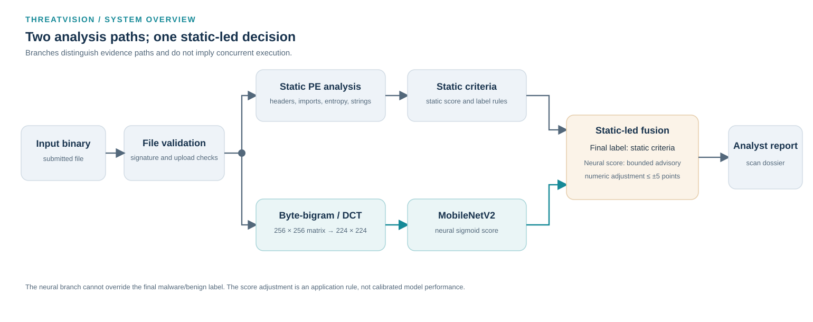

# ThreatVision

### PE triage engineering prototype and proposed malware-ML evaluation study

ThreatVision is an undergraduate software-engineering project that combines Windows Portable Executable (PE) static analysis with a byte-bigram/DCT image pipeline and a MobileNetV2-based advisory score. Static rules determine the final binary label; neural inference can adjust the numerical threat score by at most five points. This repository documents the research implementation, evidence and limits. It does not contain the application backend, model weights, private datasets or executable samples.

## Research motivation

Malware classifiers can appear effective when train and test data share sources, families, time periods or packing artifacts. A high score alone does not show that a model learned robust, malware-specific evidence. ThreatVision provides an engineering system and a basis for testing whether its frequency-domain neural signal adds information beyond conventional PE features under controlled data shift.

## Implemented system

The companion application validates an uploaded file, extracts PE static indicators, converts bytes into a grayscale frequency image, runs a saved MobileNetV2 checkpoint, and combines the neural score with static-rule scoring. The image path counts adjacent byte pairs in a 256×256 matrix, suppresses the `(0,0)` count, normalizes and quantizes the matrix, applies a two-dimensional DCT-II and log-magnitude compression, resizes to 224×224, and supplies a float32 `[0,1]` tensor. The transform follows prior work by Mohammed et al. (2021); the project contribution is its implementation and integration, not invention of the representation.



## Engineering evidence

The production checkpoint was verified against SHA-256 `1e8f713db5aa0e42bb55addb02281a700028fc9fbca784b908c77a1b9cf6aaca`, safely loaded, and run on five deterministic synthetic tensors plus one harmless PE-derived input. The distinct recovered 256×256 checkpoint has a different hash and input contract; the two artifacts are documented separately. Three harmless fixtures matched exactly between the current application and research preprocessing implementations at eight stages. Their final tensors also produced identical outputs with the real production checkpoint. A local companion-backend test exercised the harmless-PE analysis and inference path; the backend source is outside this repository, so that integration run is evidence about the companion checkout, not a self-contained public demo.

The research suite contains **38 engineering tests**. These include manifest and split checks, evaluation tooling, checkpoint identity and safe-loading guards, preprocessing parity, and a training callback regression. A one-epoch training smoke completed using temporary PE-shaped fixtures with synthetic pseudo-labels; its scores are not scientific results. None of these checks measures malware classification performance. Machine-readable checkpoint and parity results are under [`docs/audits/`](docs/audits/).

## Evidence and limitations

Historical notebook outputs, a recovered training log and two separate checkpoints do not establish the production model's training data, labels, split membership or selection history. The 46-row diagnostic pilot has no independently confirmed labels or known-malicious PE cohort; its sample-level inputs and measurements are not included. No accuracy, ROC-AUC, calibration, false-positive rate or generalization result is claimed. The available evidence establishes selected runtime behavior and current serving-to-research preprocessing parity only. See the single [experiment and checkpoint lineage register](docs/experiment-lineage.md) for historical records and the [dataset provenance note](docs/dataset-provenance.md) for remaining data gaps.

## Proposed research

**Do byte-bigram/DCT neural representations contribute predictive information beyond conventional PE static features under leakage-resistant evaluation?** The first proposed study compares pre-specified static-feature baselines with the same features plus the frozen neural score on the same lawful, independently labeled PE cohort. It requires duplicate- and lineage-aware partitions, train-only fitting, source/time holdouts and a predeclared metric. This study has not been run; a null or negative result would be informative.

## Reproduce the verified portions

Use Python 3.11 and install the research dependencies:

```bash
python3 -m pip install -r requirements-research.txt
python3 -m unittest discover -s tests -v
python3 -m compileall -q research tests
```

The safe test suite does not need malware samples or checkpoint weights. Checkpoint inference requires the exact external model file and its registered profile; parity against the production converter requires the companion application checkout. Commands and data requirements are in [Reproducibility](REPRODUCIBILITY.md).

## Project documents

- [System architecture](docs/system-architecture.md) · [Methodology](docs/methodology.md) · [Model card](docs/model-card.md)
- [Dataset provenance](docs/dataset-provenance.md) · [Experimental record](docs/experimental-record.md) · [Experiment lineage](docs/experiment-lineage.md)
- [Prospectus (PDF)](docs/research-prospectus.pdf) · [Prospectus source](docs/research-prospectus.md) · [One-page summary (PDF)](academic-outreach/Research_Summary.pdf)
- [Research background](docs/research-background.md) · [Future research](docs/future-research.md) · [References](docs/references.md)

The formal university record lists the original final-year project as a group submission by Ahsan Ali Salamat and Usman Manzoor. The technical implementation is attributed by the author to Ahsan Ali Salamat. This is an engineering portfolio and proposed research direction, not a validated malware-detection study.
