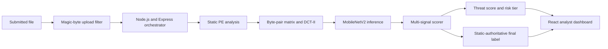
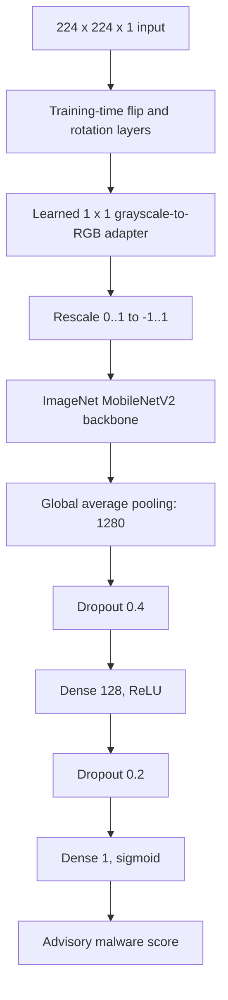
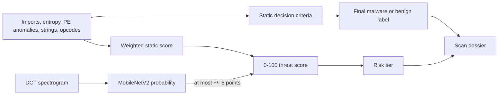
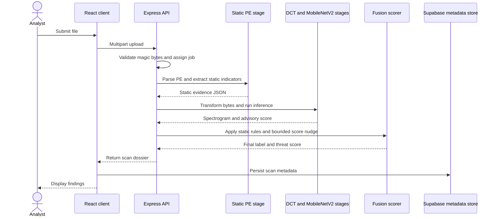
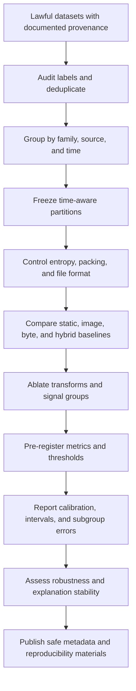

# Scientific Figures

The Mermaid source below is intended to render on GitHub. Figures 1–5 describe the audited implementation; Figure 6 is explicitly proposed research. The example spectrograms in `assets/` are feature outputs supplied in the project handoff. They are illustrative inputs only and are not labeled model-performance examples. Confirm rights and captions before public release.

## Figure 1. System architecture



*Caption: Audited application stages as listed by the implementation trace. The final binary label comes from static criteria; neural inference provides a bounded score adjustment.*

## Figure 2. Binary preprocessing and frequency transformation

```mermaid
flowchart TD
    A[Raw bytes b1 ... bn, n >= 2] --> B[Count adjacent byte pairs]
    B --> C[256 x 256 frequency matrix M]
    C --> D[Suppress M(0,0)]
    D --> E[Normalize by maximum and quantize to G]
    E --> F[Orthonormal 2D DCT-II]
    F --> G[Log magnitude: log(1 + abs(F))]
    G --> H[Rescale to 8-bit image]
    H --> I[Area resampling to 224 x 224]
    I --> J[Normalize and add channel dimension]
```

*Caption: Implemented byte-to-image process. Null suppression is a heuristic and should be evaluated by ablation.*

## Figure 3. Deployed neural model architecture



*Caption: Topology recorded for `threatvision_v01.keras`. This figure makes no performance claim.*

## Figure 4. Static analysis and neural-advisory scoring



*Caption: Static criteria have full label authority. The CNN does not determine the final malware/benign verdict.*

## Figure 5. End-to-end inference and reporting workflow



*Caption: Sequential workflow described in the implementation trace; the diagram does not imply concurrent branches.*

## Figure 6. Proposed research process



*Caption: Proposed methodology only. ThreatVision has not completed these experiments.*
