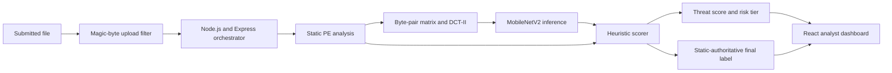
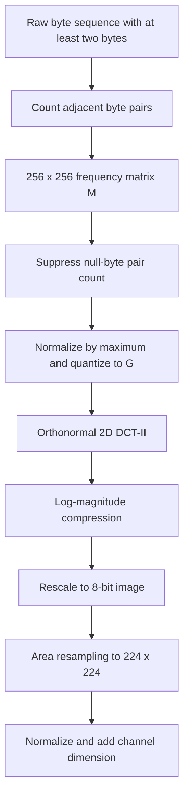
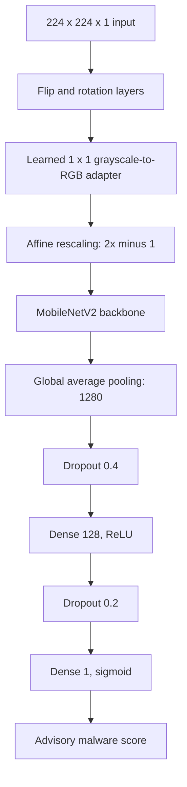
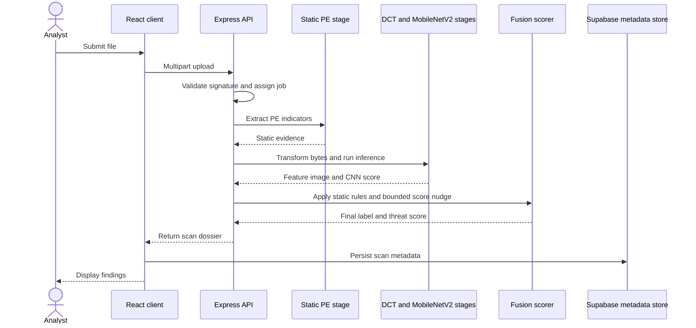
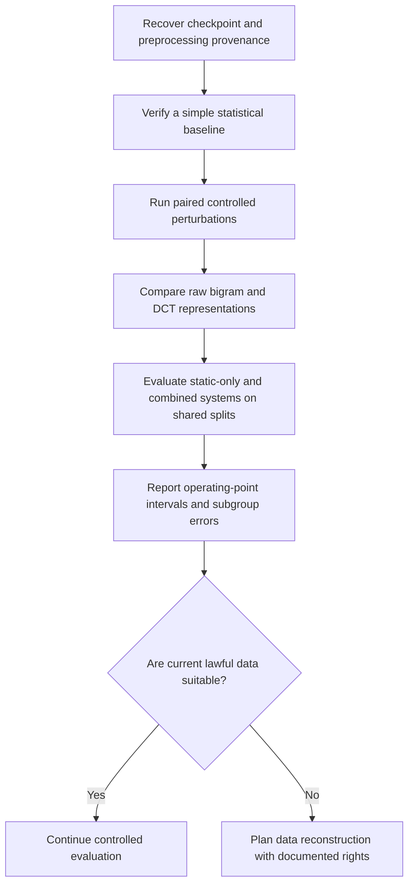

# Figures

Figures 1–5 describe the implemented workflow; Figure 6 presents proposed research. All six Mermaid diagrams were authored for this repository. The README also embeds four SVG figures; no application screenshot is included.

## Figure 1. System architecture

*Caption: The application runs upload validation, static analysis, and the visual inference path before fusion. Static criteria determine the final binary label; the CNN can change the numeric score by no more than five points.*

## Figure 2. Binary preprocessing and frequency transformation

*Caption: Implemented byte-to-image process. Suppressing `(0,0)` is an engineering heuristic; its contribution has not been tested by an ablation.*

## Figure 3. Deployed neural model architecture

*Caption: Topology recorded for `threatvision_v01.keras`. The checkpoint and its weights are not distributed here; the diagram makes no performance claim.*

## Figure 4. Static analysis and neural-advisory scoring

*Caption: Static criteria control the binary label. CNN inference can nudge the numeric score but cannot override that label.*

## Figure 5. End-to-end inference and reporting workflow

*Caption: Sequential workflow as documented for the application. It does not imply concurrent analysis branches or validated detection performance.*

## Figure 6. Proposed research process

*Caption: Proposed study design only. None of these experiments has been completed or validated for ThreatVision.*

## README SVG figures

The README embeds four self-contained SVG figures in `../figures/`:

1. [System overview](../figures/system-overview.svg): conceptual static and neural evidence paths with static-led labeling. Branches do not imply concurrent execution.
2. [Preprocessing explanation](../figures/preprocessing-explained.svg): synthetic byte sequence and schematic matrix example; it is not an observed feature map or inference result.
3. [Diagnostic response](../figures/diagnostic-response.svg): neural scores read from the private remediation CSV for two source files labeled benign PE and their overlay derivatives. The plot is descriptive and does not imply calibrated probabilities or independent samples.
4. [Proposed research roadmap](../figures/research-roadmap.svg): proposed steps, none represented as completed work.

No approved application-interface screenshot was found among the project assets inspected. The available logos and feature-image examples are not UI screenshots. Add a screenshot only after author approval, privacy review, and confirmation of redistribution rights.

The Mermaid diagrams above remain editable textual descriptions of the original workflow, preprocessing, model, scoring, reporting sequence, and proposed study. The README SVGs provide a compact visual rendering for the repository landing page.
