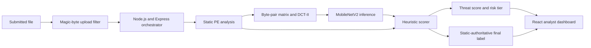
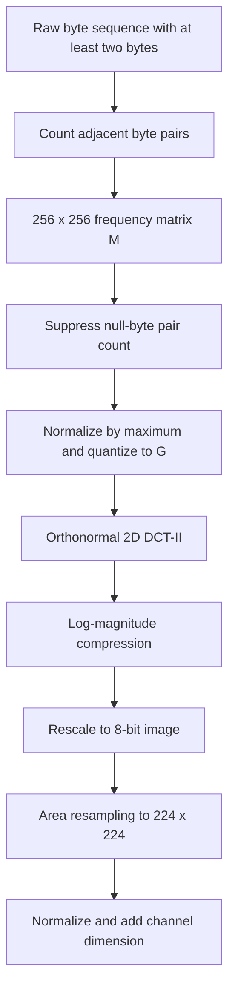
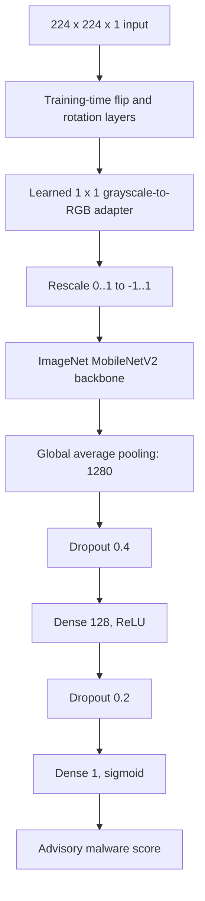
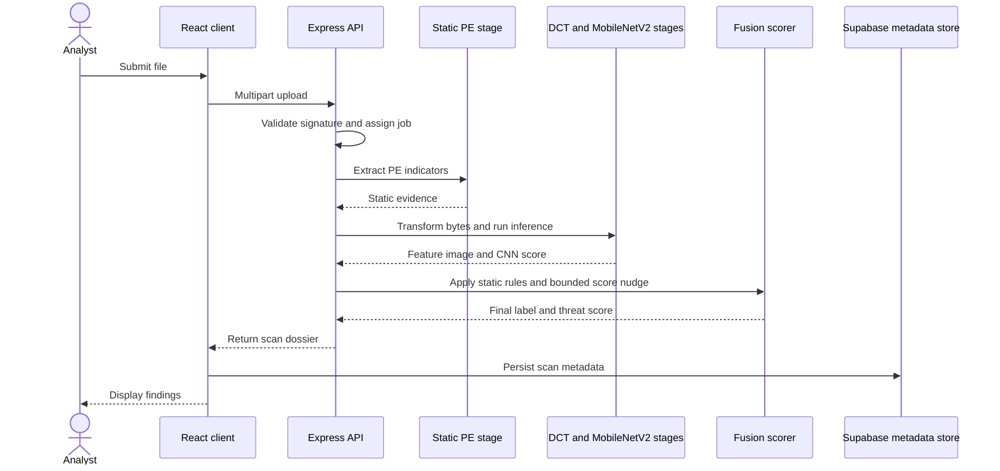
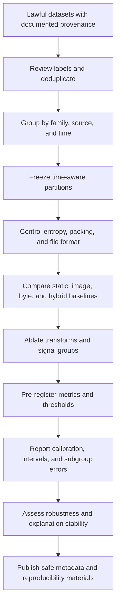
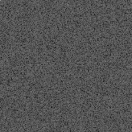
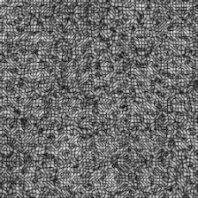

# Figures

Figures 1–5 describe the implemented workflow; Figure 6 presents proposed research. Figures 1–6 are Mermaid diagrams authored for this repository. The two PNGs in `assets/` are illustrative feature images from the project materials, not performance charts or labeled evaluation examples. Their redistribution rights have not been confirmed.

## Figure 1. System architecture

*Caption: The application runs upload validation, static analysis, and the visual inference path before fusion. Static criteria determine the final binary label; the CNN can change the numeric score by no more than five points.*

## Figure 2. Binary preprocessing and frequency transformation

*Caption: Implemented byte-to-image process. Suppressing `(0,0)` is an engineering heuristic; its contribution has not been tested by an ablation.*

## Figure 3. Deployed neural model architecture

*Caption: Topology recorded for `threatvision_v01.keras`. The checkpoint and its weights are not distributed here; the diagram makes no performance claim.*

## Figure 4. Static analysis and neural-advisory scoring

*Caption: Static criteria control the binary label. CNN inference can nudge the numeric score but cannot override that label.*

## Figure 5. End-to-end inference and reporting workflow

*Caption: Sequential workflow as documented for the application. It does not imply concurrent analysis branches or validated detection performance.*

## Figure 6. Proposed research process

*Caption: Proposed study design only. None of these experiments has been completed or validated for ThreatVision.*

## Illustrative feature images

The following project images show feature appearance only. They are not labeled malware/benign examples and do not show model outputs or performance. Redistribution permission for these images has not been confirmed.

*Caption: Example feature image identified in the project materials as high entropy. The caption does not imply a malware label or a model score.*

*Caption: Example structured feature image from the project materials. The caption does not imply a malware label or a model score.*
