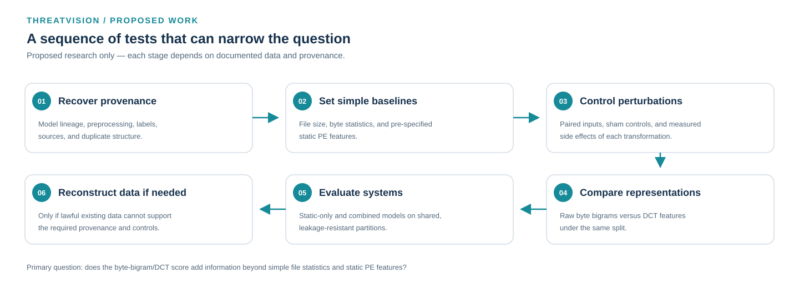

# Proposed research plan

This plan is proposed work; no malware-classification benchmark has been completed. The primary question is: **Do byte-bigram/DCT neural representations contribute predictive information beyond conventional PE static features under leakage-resistant evaluation?**

## First study: incremental value of the frozen neural score

Compare two models on the same independently labeled PE examples:

1. A regularized logistic-regression baseline using pre-specified file statistics and PE static features.
2. The same features plus the production checkpoint's frozen neural score.

Use raw files obtained under documented terms, with independent label evidence, source and collection dates, and packing status. Resolve exact and near duplicates and assign related lineage/family samples to one partition. Use immutable train, validation and test splits with source/time holdouts where data permit. Fit scaling and select model settings on training/validation data only. Freeze the test set and metric before examining final predictions. Report a paired PR-AUC difference with uncertainty resampled by independent source or family group, plus packed-benign and per-source errors. Set a practical improvement margin in advance. An inconclusive interval is not evidence of equivalence; a null or negative result is informative.

Unknown overlap between a new cohort and the production checkpoint's training data remains a limitation until model lineage is recovered. This first study tests incremental value of this checkpoint's score. It does not prove that DCT is superior to raw bigrams or that the classifier generalizes to all malware.

## Prerequisites

Before evaluation, identify lawful raw-file access and document data version, collection window, labels, duplicate handling, lineage, split assignments and checkpoint/preprocessing provenance. Public feature-only datasets cannot be assumed to contain the PE binaries required by the byte-to-image pipeline. If the current source cannot support the required comparisons, document the missing strata and rights issues before proposing a new collection. See [dataset provenance](dataset-provenance.md).

## Secondary extensions

After the first comparison is independently reviewed, useful extensions include paired controlled perturbations, raw-bigram versus DCT inputs, temporal/source shifts, packed-benign robustness, and static-only versus combined decision rules. Each extension needs its own prespecified baseline, confounders, metric and result that would count against the hypothesis. Do not infer a single-factor entropy effect from transformations that also change size, ordering or format.

## Sample size and operating points

Choose the test-set size from the target confidence interval and operating point, accounting for source/family clustering. For example, even with zero false positives among 2,000 independent benign test cases, the approximate one-sided 95% upper bound is 0.0015 (rule of three); this does not certify a false-positive rate at or below 0.001. Errors and correlated groups require more samples. No fixed timeline is promised.
